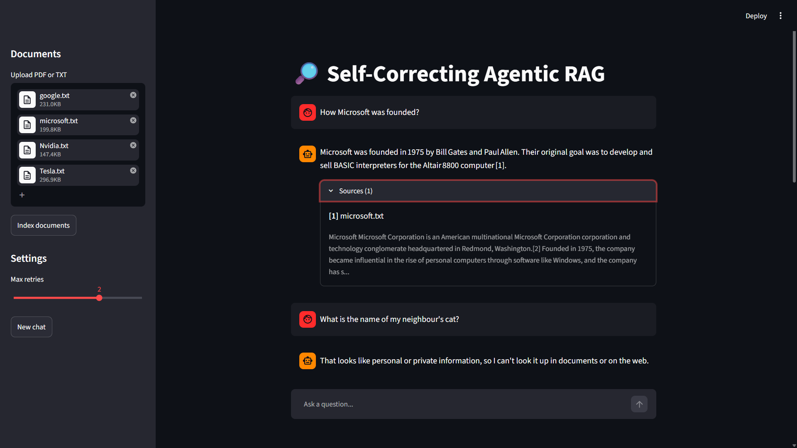
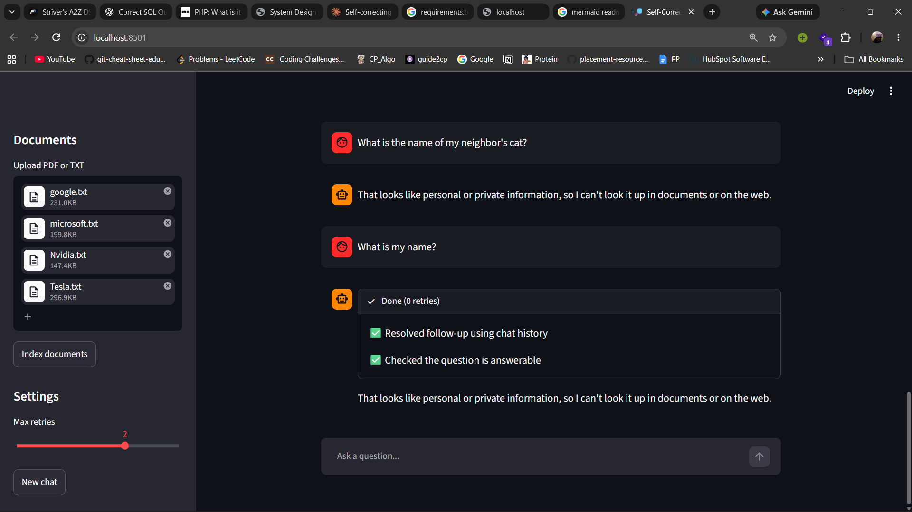
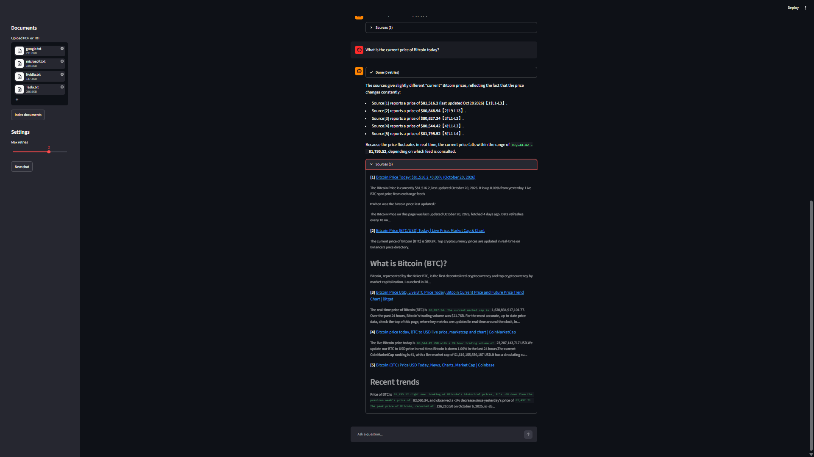
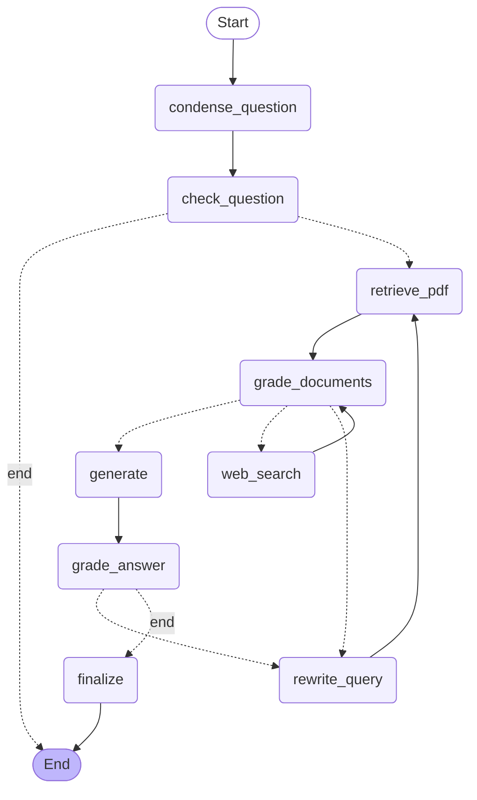

# Self-Correcting Agentic RAG System

An agentic RAG pipeline that retrieves from uploaded documents, falls back to live
web search, grades its own context and answers, and retries with rewritten queries.

## Demo

### Cited answer from documents


### Private-question guard


### Web fallback with sources


### Follow-up


## Features
- PDF/TXT semantic retrieval (Chroma + sentence-transformers) with incremental ingestion
- Live web search fallback via Tavily
- LLM-as-judge grading of retrieved context and generated answers
- Query rewriting and bounded retries (configurable max)
- Conversational memory (LangGraph checkpointer) with follow-up question handling
- Inline citations with a sources panel
- Streamlit UI showing each step the agent takes

## Architecture


## Project structure

```
Self-Correcting-Agentic-RAG-System/
├── app.py                     # Streamlit UI
├── graph/
│   ├── state.py               # GraphState schema
│   ├── grading.py             # LLM graders, rewriter, question check
│   ├── nodes.py               # one function per graph node
│   ├── edges.py               # conditional routing logic
│   └── build_graph.py         # assembles the LangGraph workflow
├── tools/
│   ├── retriever_tool.py      # PDF/TXT retrieval
│   └── web_search_tool.py     # Tavily web search
├── ingestion/
│   └── ingestion_pipeline.py  # incremental indexing into Chroma
├── docs/                      # source documents
├── run_tests.py               # scenario tests
├── requirements.txt
└── .env.example
```

## Setup
```bash
git clone <your-repo-url>
cd <repo-name>
python -m venv .venv
.venv\Scripts\activate          # Windows
pip install -r requirements.txt
copy .env.example .env          # then fill in your keys
python -m ingestion.ingestion_pipeline
streamlit run app.py
```


## Known limitations
- Graders are LLM-based and can be fooled by plausible but irrelevant text.
- Live-data answers (prices) vary by source.
- Retrieval quality depends on chunking and the embedding model.